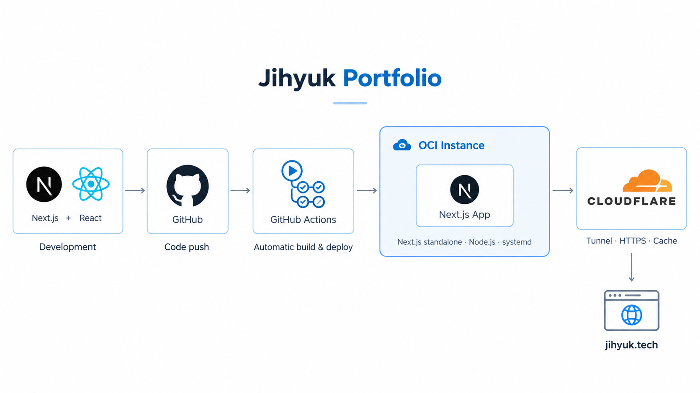
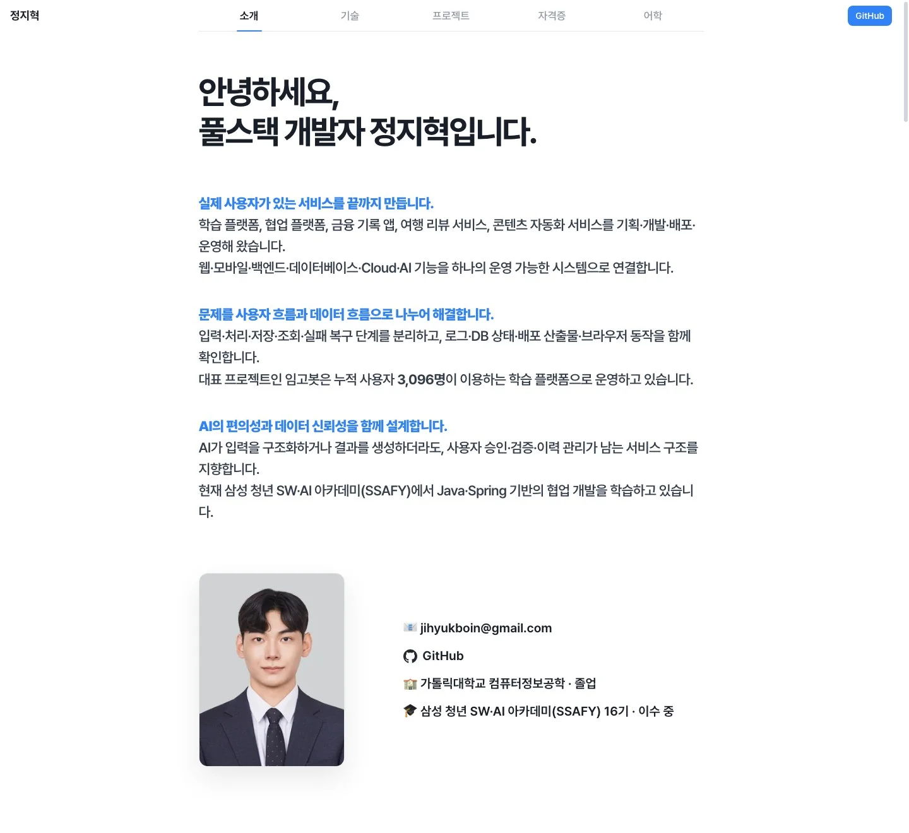
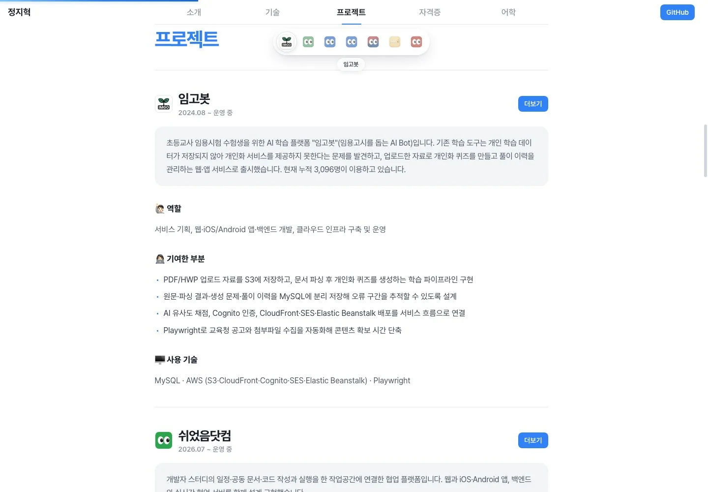
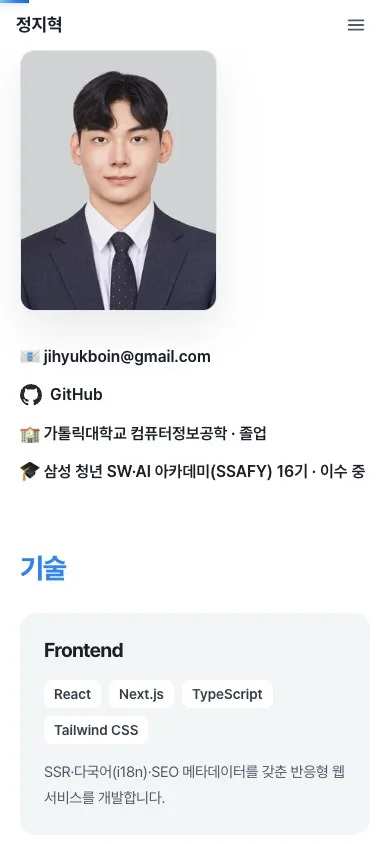

<div align="center">
  

# Jihyuk Portfolio

**웹·모바일·백엔드·Cloud를 연결해 실제 사용자가 있는 서비스를 만듭니다.**

직접 기획하고 개발·운영한 서비스, 기술과 경험을 한 페이지에 담은 정지혁의 포트폴리오

`Next.js 16` · `React 19` · `TypeScript` · `Tailwind CSS 4`

**[포트폴리오 방문 ↗](https://jihyuk.tech)**

[서비스 화면](#서비스-화면) · [주요 기능](#주요-기능) · [시작하기](#시작하기) · [콘텐츠 수정](#콘텐츠-수정)
</div>

---

## 서비스 화면

[](https://jihyuk.tech)

| 프로젝트 탐색                                                                                                       | 모바일                                                                                                       |
| ------------------------------------------------------------------------------------------------------------------- | ------------------------------------------------------------------------------------------------------------ |
|  |  |
| 프로젝트별 역할·기여·기술을 읽고 웹 서비스와 앱으로 이동합니다.                                                     | 화면 너비에 맞춰 프로필과 콘텐츠가 자연스럽게 재배치됩니다.                                                  |

> 현재 소스를 로컬 개발 서버에서 촬영한 화면입니다.

## 이 포트폴리오에 담은 것

1. **소개와 기술** — 프로필, 학력·교육, 분야별 기술과 경험을 소개합니다.
2. **직접 만든 서비스** — 임고봇, 쉬었음닷컴, 살래말래 등 프로젝트의 문제·역할·기여를 정리하고 실제 서비스와 앱 링크를 연결합니다.
3. **자격증과 어학** — 발급 기관, 취득·응시일, 등록번호와 어학 성적을 카드로 보여 줍니다.
4. **빠른 탐색** — 현재 읽는 섹션을 강조하는 메뉴, 스크롤 진행 표시, 프로젝트 아이콘 독으로 긴 페이지를 탐색합니다.

## 주요 기능

| 영역          | 구현                                                                                 |
| ------------- | ------------------------------------------------------------------------------------ |
| 반응형 화면   | 데스크톱·모바일 레이아웃, 모바일 메뉴, 가변 글자 크기와 여백                         |
| 섹션 탐색     | 고정 헤더, 스크롤 위치에 따른 활성 메뉴, 페이지 스크롤 진행 표시                     |
| 프로젝트 탐색 | 시작일 오래된 순 정렬 및 반투명 프로젝트 아이콘 독                                   |
| 공유와 검색   | Canonical, Open Graph·Twitter 메타데이터, 공유 이미지 생성, robots.txt·sitemap.xml   |
| 구조화된 정보 | ProfilePage·Person·프로젝트 목록 JSON-LD, 같은 콘텐츠 데이터에서 생성하는 llms.txt   |
| 방문 분석     | 측정 ID를 설정한 경우에만 Google Analytics 연결                                      |
| 익명 채팅     | UUID별 MySQL 대화 저장·복원, GPT-5.6 Luna 응답, UTC 날짜별 맥락·일일 500만 토큰 제한 |
| 배포          | GitHub Actions 검증, OCI standalone 배포, 헬스 체크 실패 시 이전 릴리스로 복구       |

## 기술 구성

```text
src/app/                      라우트, 공통 레이아웃과 공개 정보 경로
src/app/(portfolio)/          홈 페이지, 포트폴리오 레이아웃·메타데이터
src/components/layout/        공통 헤더, 모바일 메뉴 동작, 스크롤 진행 표시
src/components/portfolio/     포트폴리오 섹션·탐색·푸터·JSON-LD
src/app/(portfolio)/_components/chat/ 채팅 UI·브라우저 식별자·SWR 상태
src/app/api/chat/route.ts      익명 대화 조회·질문 HTTP 엔드포인트
src/lib/chat/                 공통 계약과 서버 전용 DB·OpenAI 처리
src/db/                       DB 연결·Drizzle 스키마·마이그레이션 실행
drizzle/                      검토 후 적용하는 SQL 마이그레이션
src/data/site.ts              사이트 소유자 정보
src/data/portfolio.ts         프로필·프로젝트·기술·자격증·어학 데이터
src/lib/site.ts               사이트 주소와 공통 이름
src/lib/portfolio.ts          포트폴리오 제목·설명, 프로젝트 정렬·앵커·링크·기간
src/lib/layout.ts             CSS 헤더 높이를 사용하는 브라우저 스크롤 계산
scripts/start-standalone.mjs   정적 파일을 포함한 standalone 로컬 실행
tests/e2e/                    브라우저 회귀 테스트
public/images/                프로필 사진과 프로젝트 아이콘
ops/oci/                      OCI 배포 스크립트와 systemd 설정
.github/workflows/            검증 및 운영 배포 워크플로
```

화면, 메타데이터, JSON-LD, `llms.txt`가 [src/data/portfolio.ts](src/data/portfolio.ts)를 공통으로 사용합니다. 콘텐츠를 한 곳에서 수정하면 각 출력에 함께 반영됩니다. 페이지·레이아웃·본문·JSON-LD·헤더와 모바일 메뉴의 링크 콘텐츠는 서버 컴포넌트로 구성합니다. 스크롤 탐색·프로젝트 독·메뉴 열기와 닫기는 작은 클라이언트 컴포넌트로 동작하며, 필요한 항목이나 서버에서 렌더링한 `children`만 전달받습니다. 포트폴리오 데이터와 처리 모듈은 `server-only`로 잘못된 클라이언트 import를 빌드 시 차단합니다.

공통 레이아웃에는 홈 Canonical이나 프로필 Open Graph를 정의하지 않습니다. 새 페이지는 `src/app/super-docs/page.tsx`처럼 추가하고 자체 메타데이터와 필요한 레이아웃을 정의합니다. `(portfolio)` 그룹 바깥의 페이지에는 포트폴리오 메뉴·프로젝트 독·공유 이미지가 자동 적용되지 않습니다. 공유 이미지는 `src/app/opengraph-image/route.ts`가 기존 `/opengraph-image` 주소로 제공하며, 홈 메타데이터에서 명시적으로 연결합니다. 공통 헤더를 사용할 때는 페이지에 맞는 탐색 UI를 props로 조합합니다. 섹션 스크롤을 추적하는 `PortfolioSectionNav`에 일반 페이지 경로를 추가하지 않습니다.

헤더 높이와 본문 기준 폭은 `src/app/globals.css`의 `--site-header-height`, `--site-content-width`에서 관리합니다.

## 시작하기

### 1. 설치

배포 워크플로와 같은 **Node.js 24**를 권장합니다.

```bash
git clone https://github.com/jihyukboin/jihyuk-portfolio.git
cd jihyuk-portfolio
npm ci
```

### 2. 실행

```bash
npm run dev
```

[http://localhost:3007](http://localhost:3007)에서 확인합니다. DB 기능을 사용하려면 아래 MySQL 설정을 먼저 진행합니다.

사이트 주소나 방문 분석을 설정하려면 루트에 `.env.local`을 만듭니다.

```dotenv
NEXT_PUBLIC_SITE_URL=http://localhost:3007
# Google Analytics를 사용할 때만 추가합니다.
# NEXT_PUBLIC_GA_MEASUREMENT_ID=G-XXXXXXXXXX
```

`NEXT_PUBLIC_SITE_URL`은 Canonical·공유 정보·사이트맵·JSON-LD의 기준 주소입니다. 생략하면 `http://localhost:3007`을 사용합니다. `NEXT_PUBLIC_*` 값은 빌드 시 반영되므로 변경 후에는 다시 빌드합니다.

### MySQL 연결과 마이그레이션

기존 Docker MySQL에 `jihyuk_portfolio` 데이터베이스와 전용 계정을 생성한 뒤, 루트의 `.env.local`에 접속 정보를 설정합니다. 현재 로컬 환경에는 생성 및 설정되어 있습니다. `.env.local`은 Git에 포함하지 않습니다.

```dotenv
DATABASE_URL=mysql://jihyuk_portfolio:<URL 인코딩한 비밀번호>@127.0.0.1:3306/jihyuk_portfolio
```

앱을 컨테이너에서 실행할 때는 `127.0.0.1` 대신 같은 Docker 네트워크의 MySQL 서비스 이름을 사용합니다. 운영에서는 환경 변수로 주입합니다. 접속 계정의 권한은 해당 데이터베이스로 제한하며, 마이그레이션을 위해 테이블 생성·변경 권한도 필요합니다. 데이터베이스와 계정 자체는 최초 한 번 준비하며 앱이 생성하지 않습니다.

DB 접근은 `src/db/index.ts`의 서버 전용 `getDb()`를 사용합니다. Drizzle ORM과 `mysql2` 커넥션 풀을 재사용하며, 날짜는 UTC로 처리합니다. `src/db/schema.ts`에 대화방(`chat_conversations`), 질문·답변과 사용량(`chat_turns`), 날짜별 전체 예산(`chat_daily_usage`)을 정의합니다.

```bash
# 스키마 변경 후 SQL 생성 → 검토 → 생성 파일을 Git에 포함
npm run db:generate
# 서버 시작 없이 연결 확인 및 미적용 SQL 적용
npm run db:migrate
# 로컬 DB 관리 화면
npm run db:studio
```

`npm run dev`, `npm start`, standalone 서버는 Next.js의 `src/instrumentation.ts`에서 요청 처리 전에 DB 연결과 미적용 마이그레이션을 실행합니다. MySQL이 아직 준비되지 않았으면 연결을 최대 10회 시도합니다. 인증 오류나 마이그레이션 실패 시 서버 시작을 중단합니다. 같은 DB에서 동시에 시작할 때는 MySQL 잠금으로 마이그레이션 실행을 직렬화합니다. 이력은 `__drizzle_migrations` 테이블에 기록하므로 재시작해도 같은 SQL을 다시 실행하지 않습니다.

`DATABASE_URL`이 없는 경우에는 현재 정적 포트폴리오와 CI 미리보기를 위해 DB 초기화만 생략합니다. DB 접근 함수와 수동 `db:migrate` 명령은 환경 변수가 없으면 실패합니다. `next build`에서는 DB 연결을 요구하지 않습니다. 빌드 후 마이그레이션 폴더를 standalone 결과물에 복사하므로 배포 시 `.next/standalone` 전체를 포함해야 합니다. 운영 DB 연결 정보와 계정 준비는 별도 적용해야 합니다.

### 익명 채팅

`.env.local`에 `OPENAI_API_KEY`를 설정합니다. 키는 서버에서만 읽으며 모델은 `gpt-5.6-luna`로 고정합니다. 입력을 시작하면 `localStorage`의 `portfolio.chat.visitor`에 UUID를 발급합니다. 이 값은 로그인 없는 대화 조회용 비밀 식별자이며 URL에 넣지 않습니다. 서버는 SHA-256 해시로 방문자를 연결합니다. 로컬 저장소를 삭제하면 이전 대화에 다시 접근할 수 없습니다.

클라이언트는 Next.js Route Handler에 JSON을 보내고, 서버 전용 모듈에서 입력 검증·DB 접근·OpenAI 호출을 수행합니다. 브라우저 저장소에 의존하는 대화 조회와 재검증은 SWR로 처리합니다. 일반 페이지는 기존처럼 Server Component로 렌더링합니다.

맥락은 Responses API의 `previous_response_id`로 연결합니다. 방문자마다 UTC 날짜별로 별도 대화방을 만들기 때문에 UTC 00:00(한국 오전 9시)에 새 체인이 시작됩니다. 당일 대화만 UI에 복원하며 지난 날짜의 기록은 MySQL에 보존합니다. 대화 상태 관리 방식은 [OpenAI 공식 문서](https://developers.openai.com/api/docs/guides/conversation-state)를 따릅니다. 매 요청에 포트폴리오 원본 데이터로 만든 안내 지침을 다시 전달합니다.

무료 사용량 제한은 방문자별이 아닌 서비스 전체 하루 5,000,000토큰입니다. 이전 맥락을 포함하는 입력 토큰을 API로 먼저 계산하고 최대 출력 2,048토큰을 더해 MySQL 트랜잭션으로 예약합니다. 응답의 `usage.total_tokens`로 정산하며 입력·캐시된 입력·추론을 별도로 중복 가산하지 않습니다. 같은 방문자의 요청은 직렬화하고 요청 UUID로 중복 생성을 방지합니다. SDK 자동 재시도는 비활성화합니다.

명시적인 API 거절은 예약을 반환합니다. 연결 유실이나 서버 중단으로 실제 사용량을 확인할 수 없으면 예약량 전체를 보수적으로 사용 처리합니다. 다음 조회·전송에서 중단된 요청을 복구하며, 이전 날짜의 사용량은 새 날짜로 이월하지 않습니다. 앱의 한도는 OpenAI 계정의 무료 적용 여부·다른 앱의 사용량과 별개입니다.

DB 통합 테스트는 별도 `_test` 데이터베이스만 사용하며 테스트마다 채팅 테이블을 비웁니다. 현재 로컬에는 `jihyuk_portfolio_test`를 만들고 `.env.local`에 `TEST_DATABASE_URL`을 설정했습니다.

```bash
# 별도 테스트 DB + 모의 OpenAI 서버로 실제 HTTP·MySQL 흐름 검증
npm run test:chat
```

브라우저 테스트는 채팅 API를 모의 응답으로 대체하므로 OpenAI를 호출하지 않습니다. 실제 OpenAI 호출에는 현재 계정의 모델 접근 권한과 API 사용 가능 상태가 필요합니다.

### 3. 검증과 빌드

```bash
npm run lint
npm run typecheck
npm run build
npm run start:standalone
```

`start:standalone`은 운영 배포처럼 정적 파일과 `public`을 복사한 뒤 standalone 서버를 실행합니다. 기본 포트는 `3000`이며, `3007`에서 확인하려면 `PORT=3007 npm run start:standalone`을 사용합니다. `typecheck`는 Next.js 타입을 생성한 뒤 TypeScript 검사를 실행합니다.

브라우저 회귀 테스트는 Chromium을 한 번 설치한 뒤 실행합니다.

```bash
npx playwright install chromium
npm run test:e2e
```

`test:e2e`는 프로덕션 빌드 후 `127.0.0.1:3108`에서 standalone 서버를 실행합니다. JavaScript 비활성 상태의 본문, 메타데이터와 공개 정보 경로, 섹션·프로젝트 탐색, 모바일 메뉴와 화면 전환, 기존 공유 앵커를 검증합니다. 테스트 서버는 실행 후 자동 종료됩니다.

## 콘텐츠 수정

| 바꾸려는 내용                    | 수정 위치                                                                        |
| -------------------------------- | -------------------------------------------------------------------------------- |
| 프로필·기술·프로젝트·자격증·어학 | [src/data/portfolio.ts](src/data/portfolio.ts)                                   |
| 섹션 배치                        | [src/app/(portfolio)/page.tsx](<src/app/(portfolio)/page.tsx>)                   |
| 메뉴 이름·순서                   | [src/components/portfolio/navigation.ts](src/components/portfolio/navigation.ts) |
| 사이트 주소·공통 이름            | [src/lib/site.ts](src/lib/site.ts)                                               |
| 포트폴리오 제목·설명             | [src/lib/portfolio.ts](src/lib/portfolio.ts)                                     |
| 사이트 소유자·연락처             | [src/data/site.ts](src/data/site.ts)                                             |
| 공유 이미지                      | [src/lib/portfolio-open-graph.tsx](src/lib/portfolio-open-graph.tsx)             |
| 프로필 사진·프로젝트 아이콘      | [public/images](public/images)                                                   |

프로젝트는 `startedOn`이 오래된 순으로 정렬합니다. 프로젝트 `id`는 정렬 순서와 무관한 앵커(`/#project-imgobot` 등)에 사용하므로 변경하지 않습니다. `legacyAnchorId`는 기존에 공유된 숫자 앵커를 유지하는 별칭이며 신규 프로젝트에는 추가하지 않습니다. 섹션 순서를 변경할 때는 메뉴 순서도 함께 맞춥니다.

## 운영 배포

```text
main push → GitHub Actions 검증 → OCI 빌드·standalone 릴리스
          → systemd 재시작·헬스 체크 → Cloudflare 콘텐츠 캐시 갱신
```

워크플로는 의존성 설치, lint, 타입 검사, 빌드, 브라우저 회귀 테스트를 통과한 뒤 `production` 환경으로 배포합니다. OCI에서는 릴리스 디렉터리를 만들고 현재 릴리스 링크를 교체하며, 서버는 `127.0.0.1:3010`에서 실행됩니다.

GitHub `production` 환경의 SSH 접속·사이트·Cloudflare 설정은 [배포 워크플로](.github/workflows/deploy-production.yml)를, 서버 구성과 환경변수 동기화는 [OCI 운영 문서](ops/oci/README.md)를 참고하세요.

---

<div align="center">
  <a href="https://jihyuk.tech">jihyuk.tech</a> ·
  <a href="https://github.com/jihyukboin">GitHub</a> ·
  <a href="mailto:jihyukboin@gmail.com">Email</a>
</div>
